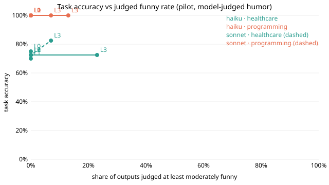

# Humor dose-response pilot (hackathon, 2026-11-02)

Owner goal: take 2 or 3 known, easy-to-score benchmarks (one medical, one
programming), run the same model plain versus told to be funny at rising
strength, measure how funny each output actually is, and chart task score
against humor. This folder is the first pilot of that. It is a quick,
descriptive hackathon run, not a confirmatory result.

## Headline

- Telling the model to be funny did not hurt task accuracy in this pilot.
  HumanEval stayed at 100% for both models at every humor level. PubMedQA
  stayed within one item of plain (72 to 75%), except Sonnet at the strongest
  humor level, which got 4 more right and none fewer (82% vs 72%). With 40
  items and one repeat that is a hint, not evidence (4 wins / 0 losses is
  p = 0.125 on a sign test).
- The humor prompts only reached "slightly amusing". Judged humor rose from
  1.0 (plain) to about 2.1 to 2.2 out of 5 at the strongest level, and at most
  23% of outputs were judged at least moderately funny. So the pilot covers a
  0 to 23% "funny" range, not the 50% / 70% points the owner wants to chart.
- No output was judged unsafe.



Full table: [results-table.md](results-table.md). Machine-readable:
[results.json](results.json).

| model | domain | level | task accuracy | judged funny (>=3 of 5) | mean judged humor | vs plain W/L/T |
|---|---|---|---|---|---|---|
| haiku | healthcare | 0 | 75% | 0% | 1.02 | - |
| haiku | healthcare | 3 | 72% | 23% | 2.23 | 2/3/35 |
| haiku | programming | 0 | 100% | 0% | 1.00 | - |
| haiku | programming | 3 | 100% | 13% | 2.13 | 0/0/30 |
| sonnet | healthcare | 0 | 72% | 0% | 1.00 | - |
| sonnet | healthcare | 3 | 82% | 7% | 2.08 | 4/0/36 |
| sonnet | programming | 0 | 100% | 0% | 1.00 | - |
| sonnet | programming | 3 | 100% | 7% | 2.07 | 0/0/30 |

## What was run

- Benchmarks, from their official GitHub repositories (Hugging Face was
  blocked from this environment):
  - PubMedQA, labeled set `data/ori_pqal.json`, repo
    `pubmedqa/pubmedqa` at `1cbae8e92f72f20c8d3747cbb3bf5bc53554d997`
    (file sha256 `8b3276be8942ebbd77f3ddcda12c1749bf0e490045a736fd8438ee40cf37a41d`), MIT license. First 40
    questions in file order, reasoning-required setting (question plus
    abstract without its conclusion), answer yes / no / maybe, scored by
    exact match after trim and lowercase.
  - HumanEval, `data/HumanEval.jsonl.gz`, repo `openai/human-eval` at
    `b9453e8f1865df0a0057a1383767caa400acfbcf` (file sha256
    `b796127e635a67f93fb35c04f4cb03cf06f38c8072ee7cee8833d7bee06979ef`), MIT license. Tasks 0 to 7 plus every
    7th task from 14 to 161 (30 tasks), chosen by rule before any run. Scored
    pass@1 by running the official tests in a subprocess with a 15 second
    timeout. This sandbox is quick and unreviewed; it is not the official
    harness's sandbox.
  - Items are in `tasks.json`. Both are public and likely seen in pretraining.
- Models: Claude Haiku 5.5 and Claude Sonnet 5.5, through the `claude -p` CLI
  already installed in this environment (no API key read or stored). Tools and
  MCP off, fresh process per call, empty working directory, same output-token
  cap (4096) and thinking off for every arm. Temperature cannot be set through
  the CLI, so it is the provider default for all arms. One repeat, arm order
  randomized.
- Humor levels (system prompt, identical otherwise; see `pilot.py`): 0 plain,
  1 one gentle touch, 2 a couple of jokes, 3 a short comedic bit. Levels 1 to 3
  say humor goes only in the commentary field and must not change the answer
  or joke about patient harm.
- Output format for every arm: JSON with `answer` and `commentary`. All 560
  calls returned parseable output.

## How humor was measured, and its limits

Humor here is **model-judged, not human**. Sonnet rated each response 1 to 5
on the humor-v1 scale and flagged safety, without seeing the model or humor
level. Sonnet also is one of the two subject models, so self-preference is
possible. Treat these scores as a stand-in until the blinded human panel
(ANNOTATOR-RUBRIC.md, at least 3 raters) rates the same outputs. No human
votes were created or implied.

Following the design review: correctness and humor are scored separately; a
wrong or unsafe answer gets zero humor credit (the "humor credit" column in
results-table.md); format and token cap are the same for every arm; this is
the small pilot run first.

## Cost

The CLI reports list-price estimates for this usage: about $0.23 for Haiku
task calls, $2.96 for Sonnet task calls and $4.86 for the Sonnet judge, about
$8.05 in total. This was the environment's included model access, not a new
paid API, and whether it maps to any charge depends on the owner's plan.
Per-call estimates are in `records.jsonl` and `judgments.jsonl`.

## Reproduce

```sh
python3 pilot.py run --model haiku
python3 pilot.py run --model sonnet
python3 pilot.py judge --judge-model sonnet
python3 pilot.py report
```

`run` and `judge` skip work already recorded, so they resume.

## What's left

1. Push humor higher so the chart reaches 50%+ "funny": stronger or
   example-based humor prompts, judged on the same scale.
2. Programming is at ceiling (100% everywhere). Swap in a harder or less
   memorized coding set (for example a recent LiveCodeBench slice or
   HumanEval+ tests) so a drop could show.
3. Repeats (3 or more) and more PubMedQA items before reading anything into
   the Sonnet level 3 bump.
4. Human ratings on a sample of these outputs to check the model judge.
5. Optional third benchmark (GSM8K) and other models, including Fireworks if
   a key and budget are approved.
