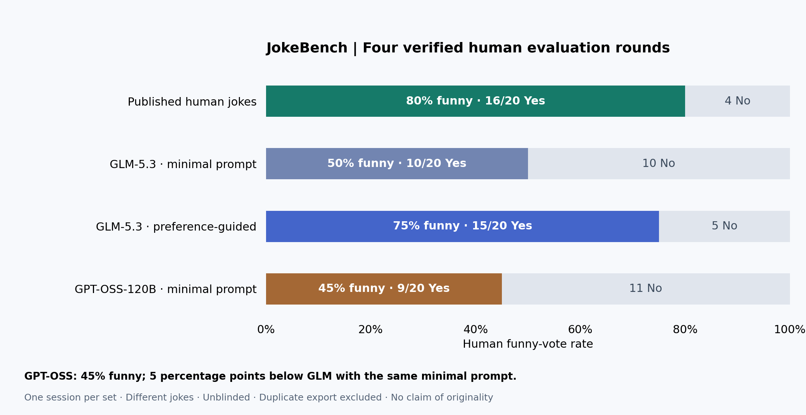

# Fireworks JokeBench archive

Eight 20-item datasets (160 items), four unique completed human rating sessions (80 votes), generation prompts, and comparison charts collected on 2026-11-02. These are separate from the repository's existing 60-item OpenRouter dataset and are not loaded into its rater automatically.

## Verified human scores

| Round | Funny / rated | Funny-vote rate |
| --- | --- | --- |
| Published human jokes | 16/20 | 80% |
| GLM-5.3 preference-guided | 15/20 | 75% |
| GLM-5.3 minimal prompt | 10/20 | 50% |
| GPT-OSS-120B minimal prompt | 9/20 | 45% |

The three-round chart is retained as a historical artifact; the four-round chart adds GPT-OSS. No human score has been supplied for Nemotron, guided GPT-OSS (skipped), or strict-punchline GPT-OSS. Unrated does not mean zero. Duplicate exports of session `411e7992-adc6-40bf-b596-0fa3696e5843` have identical ratings and are included once.

## Files and interpretation

- `manifest.json`: dataset inventory and matching human sessions.
- `datasets/*/items.jsonl`: exact joke text and IDs; published jokes retain performer and source attribution.
- `datasets/*/request.json`: exact generation request, including examples and sampling settings. No API credentials.
- `datasets/*/generation-metadata.json`: usage and completion metadata; no reasoning traces.
- `human-ratings/*.json`: supplied exports, one per session, retaining individual Yes/No votes and provenance.
- `results/`: scores and historical/current charts.
- `recognition/`: separate synthetic joke/non-joke protocol and GLM summary (19/20, 95%). This is recognition accuracy, not human funniness.

The only collected human rubric here is **Is this funny? Yes / No**. These votes cannot establish 1–5 funniness, freshness, or the other proposed attribute scores. The synthetic recognition labels are seed labels, not independently validated gold labels; N07 is a known ambiguous literal/deadpan case.

## Prompt comparability and limitations

The two minimal-prompt requests differ only in model. The preference-guided GLM, Nemotron, and first guided GPT-OSS requests likewise share the final GLM prompt and settings apart from model. That prompt includes prior human ratings and a stock-joke exclusion list. Its inherited “last attempt” wording describes GLM's earlier retry, not prior attempts by the other models. GLM's final preference-guided batch was selected after earlier failed/rejected attempts; it is not a one-shot randomized comparison. The latest GPT-OSS strict-punchline round uses a revised prompt and must remain separate.

Each scored set has one reviewer session; model identity was visible, joke sets differ and may overlap, and the preference examples came from the same reviewer. Differences are descriptive, not causal proof of prompting improvements or a general model ranking. None of these results establishes originality. Published jokes retain their original rights; inclusion here grants no blanket license or authorship claim. Generated text may also repeat familiar jokes.

Failed generation attempts without a complete 20-item dataset (Nemotron revision, Llama and Mistral deployment checks), credentials, local browser state, and raw reasoning traces are excluded.

## Validation

Run `python3 scripts/validate-fireworks-archive.py` from the repository root. It checks counts, IDs, vote completeness, dataset-to-rating text matches, duplicate sessions, and recomputed scores.
